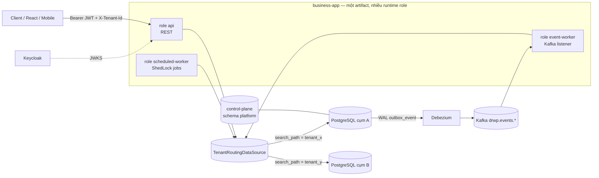
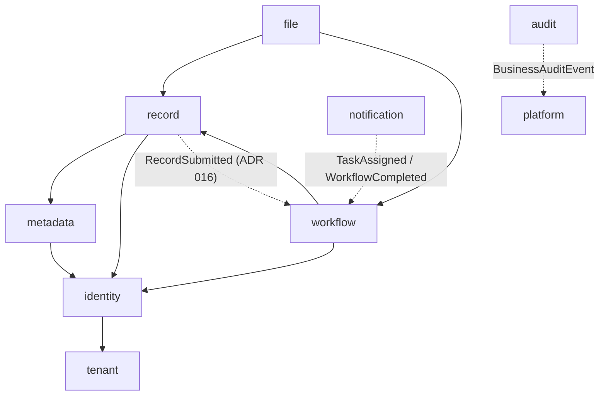

# DRWP — Dynamic Record & Workflow Platform (backend)

Nền tảng đa đơn vị (multi-tenant) cho phép **cấu hình biểu mẫu, hồ sơ, quy trình phê duyệt và phân quyền** mà không phải
phát hành lại ứng dụng. Backend được xây theo **DDD Modular Monolith** đúng các quyết định trong
`05-ADR-MODULAR-MONOLITH.md` (ADR 011–024) và baseline `01-THIET-KE-KIEN-TRUC.md` / `02-RANG-BUOC-VA-ATTT.md`.

> **Gateway (`gateway-app`) tạm thời để trống** — xem [`gateway-app/README.md`](gateway-app/README.md).
> `business-app` tự xác thực JWT nên chạy độc lập được.

| | |
|---|---|
| Ngôn ngữ / runtime | Java 25, Spring Boot 4.1.2, Spring Framework 7.0, Spring Security 7.1 |
| Modular monolith | Spring Modulith 2.1.2 (`verify()` + event publication registry JDBC) + ArchUnit 1.5 |
| Dữ liệu | PostgreSQL 16, **schema-per-tenant + tenant placement** nhiều cụm, Flyway 12 theo từng module |
| Sự kiện | Nội bộ: Spring Modulith (`@ApplicationModuleListener`); ra ngoài: outbox → Debezium → Kafka |
| Bảo mật | OIDC/JWT (Keycloak), bitmask RBAC + ABAC (ownership, assignment, trạng thái quy trình) |
| Job | ShedLock trên control-plane, phát lại registry theo từng tenant |

Hướng dẫn từng bước: **[docs/GUIDE.md](docs/GUIDE.md)** · Tham chiếu DSL biểu mẫu/quy trình: **[docs/DSL-REFERENCE.md](docs/DSL-REFERENCE.md)**
· ADR bổ sung khi triển khai: **[docs/adr/ADR-025-028.md](docs/adr/ADR-025-028.md)**

---

## 1. Kiến trúc



### Module (bounded context) và quan hệ

| Module | Maven artifact | Tiền tố bảng | Public contract (`api`) | Phụ thuộc |
|---|---|---|---|---|
| tenant | `module-tenant` | control-plane `platform.*` | `TenantMembershipReader/Writer`, `TenantInitializer` | platform |
| identity | `module-identity` | `idn_` | `PermissionChecker`, `RoleDirectory` | tenant |
| metadata | `module-metadata` | `meta_` | `FormDefinitionReader`, `FormPublished` | identity |
| record | `module-record` | `rec_` | `RecordReferenceReader`, `RecordLifecycle`, `RecordAttachmentPolicy`, `RecordSubmitted`, `RecordStatusChanged` | metadata, identity |
| workflow | `module-workflow` | `wf_` | `TaskAssigned`, `WorkflowCompleted`, `WorkflowParticipation` | record, identity |
| file | `module-file` | `file_` | `DocumentUploaded` | record, workflow, identity |
| notification | `module-notification` | `noti_` | — | workflow, identity |
| audit | `module-audit` | `aud_` | — (nghe `BusinessAuditEvent`) | identity |
| platform | `platform-kernel/core/web` | `event_publication`, `outbox_event`, `inbox_event` | shared (OPEN) | — |

Bên trong mỗi module: `api/` (public, `@NamedInterface`), `application/` (use case), `domain/` (Java thuần,
không framework — ArchUnit kiểm tra), `infrastructure/` (JDBC, REST, cấu hình).



### Cấu trúc thư mục

```text
drwp/
├── pom.xml                         # reactor; parent = spring-boot-starter-parent 4.1.2
├── platform/
│   ├── platform-kernel/            # Java thuần: TenantId, Action/PermissionMask, Condition DSL, lỗi, BusinessAuditEvent
│   ├── platform-core/              # tenancy (routing DS, placement, migrator), messaging (outbox, inbox, Kafka worker), runtime role
│   └── platform-web/               # Spring Security (JWT), TenantResolutionFilter, Problem Details
├── modules/{tenant,identity,metadata,record,workflow,file,notification,audit}/
├── business-app/                   # deployable #2 + test kiến trúc + test tích hợp
├── gateway-app/                    # deployable #1 — CHƯA TRIỂN KHAI
├── infrastructure/{compose,keycloak,debezium,postgres}/
└── docs/
```

## 2. Các ADR được hiện thực ở đâu

| ADR | Hiện thực |
|---|---|
| 011 Đội < 10 người, một codebase | Một reactor Maven, một phiên bản, một nhịp phát hành |
| 012 Sự kiện nội bộ = Modulith, Kafka chỉ cho sự kiện ra ngoài | `@ApplicationModuleListener` cho mọi luồng giữa module; `OutboxWriter` chỉ cho sự kiện externalized |
| 013 Gateway không chứa nghiệp vụ | `gateway-app` để trống; business-app tự xác thực JWT (`SecurityConfiguration`) |
| 014 Ranh giới bằng Maven + Modulith + ArchUnit | Mỗi module một artifact; `ModularityTest.verify()`, `ArchitectureRulesTest` |
| 015 Tiền tố bảng, cấm JOIN/FK xuyên module | Migration theo module (`db/tenant/<module>/`); `TableOwnershipTest` lint migration + SQL trong mã nguồn |
| 016 Nộp hồ sơ và khởi tạo quy trình là hai transaction | `RecordService.submit` phát `RecordSubmitted`; `WorkflowRuntimeService.onRecordSubmitted` (idempotent theo `submissionId`); UI thấy trạng thái `SUBMITTED` → `IN_PROGRESS` |
| 017 Workflow là process manager, không saga framework | `StateMachine` (thuần) + `wf_instance/wf_task/wf_transition_history`; timeout từng bước (`TaskTimeoutJob`) |
| 018 Runtime role | `@ConditionalOnRuntimeRole`; profile `api`, `event-worker`, `scheduled-worker` |
| 019 Registry trong từng schema tenant | Bảng `event_publication` tạo bởi migration `platform`; `TenantRoutingDataSource` → ghi cùng transaction, đúng schema; `EventPublicationMaintenanceJob` phát lại theo từng tenant |
| 020 Outbox + Debezium | `outbox_event` (cột theo EventRouter), connector `infrastructure/debezium/outbox-cluster-*.json` bắt `tenant_.*\.outbox_event` |
| 021 Tenant context cho listener async | `TenantContextTaskDecorator` + `TenantEventGuardAspect` (từ chối sự kiện lệch tenant) |
| 022 Nguồn tin cậy của tenantId Kafka | `ExternalEventConsumer.verify`: schema nguồn (header Debezium) → `tenant_placement` → so với payload/header; lệch → DLT + log `SECURITY` |
| 023 Tiêu chí tách service | Không tách; module chỉ giao tiếp qua `api` + sự kiện, sẵn sàng tách khi có tín hiệu |
| 024 Kiểm thử theo module | Unit test domain mỗi module; `TenantIsolationIntegrationTest` (2 cụm, 2 tenant); `RecordWorkflowFlowIntegrationTest` (luồng xuyên module) |

Ngoài ra: ADR 002 (custom state machine), 003 (schema-per-tenant + placement), 005 (bitmask + ABAC),
006 (phiên bản bất biến — kiểm tra ở service **và** trigger DB), 009 (JSONB hybrid).

## 3. Chức năng đã có

**Tenant (control-plane)** — provision tenant (registry → placement → migration schema → khởi tạo vai trò → membership admin → ACTIVE,
chạy lại được nếu lỗi giữa chừng), suspend/activate, migrate lại; danh sách tenant của người dùng.

**Identity** — vai trò, quyền bitmask theo resource (`*`, `record:*`, `record:LEAVE`, `wf:LEAVE_APPROVAL`, `metadata`, ...),
explicit deny thắng, chống leo thang đặc quyền (chỉ cấp được bit mình đang có), thành viên + gán vai trò, cache quyền
theo `(tenant, subject, resource, policyVersion)` nên thu hồi có hiệu lực ngay.

**Metadata** — biểu mẫu động 12 kiểu trường, validator allowlist (min/max, độ dài, regex an toàn có timeout, `requiredIf`),
vòng đời DRAFT → PUBLISHED (bất biến) → DEPRECATED, xem trước validate, checksum phiên bản.

**Record** — hồ sơ JSONB gắn đúng phiên bản biểu mẫu, mã hồ sơ tự sinh `<FORM>-<năm>-<số>`, revision đầy đủ,
optimistic locking, tìm kiếm có whitelist (lọc trường động chỉ với trường `filterable`), ẩn trường `sensitive` trong danh sách,
chống BOLA (không có quyền → 404).

**Workflow** — định nghĩa + phiên bản bất biến, gắn với loại hồ sơ; trạng thái TASK/DECISION/END; phân công ROLE/USER/SUBMITTER/FIELD;
guard theo dữ liệu hồ sơ; rẽ nhánh tự động; approve/reject/return (trả lại để bổ sung và nộp lại); comment bắt buộc;
timeout từng bước; hủy/rút; hộp việc; lịch sử chuyển trạng thái; chống xử lý trùng (khóa dòng + version + unique index);
transition bị từ chối được audit `DENIED`.

**File** — upload kiểm tra kích thước/kiểu/đuôi/magic bytes, SHA-256, lưu filesystem (dev) hoặc MinIO private;
quyền xem theo hồ sơ (chủ hồ sơ / VIEW / người tham gia quy trình); audit tải về.

**Notification** — hộp thông báo theo người dùng khi được giao việc, khi hồ sơ kết thúc; idempotent; phát
`NotificationCreated` qua outbox để gateway đẩy WebSocket sau này.

**Audit** — nhật ký nghiệp vụ append-only (trigger chặn UPDATE/DELETE), idempotent khi phát lại, tra cứu có quyền `AUDIT`.

## 4. Chạy nhanh

Yêu cầu: **JDK 25**, Maven 3.9+, Docker (cho PostgreSQL và test tích hợp).

```bash
# 1. Hạ tầng tối thiểu (PostgreSQL cụm A + B, Keycloak)
docker compose -f infrastructure/compose/docker-compose.yml up -d postgres-a postgres-b keycloak

# 2. Build + test (test tích hợp tự dùng Testcontainers nếu có Docker)
mvn verify

# 3. Chạy all-in-one với token dev (không cần Keycloak)
mvn -pl business-app spring-boot:run -Dspring-boot.run.profiles=dev
```

Sau đó làm theo [docs/GUIDE.md](docs/GUIDE.md) để provision tenant, tạo biểu mẫu, quy trình, nộp và duyệt hồ sơ bằng `curl`.

### Runtime role

```bash
java -jar business-app/target/business-app-0.1.0-SNAPSHOT.jar --spring.profiles.active=api               # cổng 8080
java -jar business-app/target/business-app-0.1.0-SNAPSHOT.jar --spring.profiles.active=event-worker      # cổng 8081 (actuator)
java -jar business-app/target/business-app-0.1.0-SNAPSHOT.jar --spring.profiles.active=scheduled-worker  # cổng 8082 (actuator)
# hoặc toàn bộ stack: docker compose -f infrastructure/compose/docker-compose.yml --profile app up -d --build
```

## 5. Cấu hình chính

| Thuộc tính | Ý nghĩa |
|---|---|
| `drwp.runtime.roles` | `api,event-worker,scheduled-worker` (mặc định cả ba) |
| `drwp.tenancy.clusters.<id>.{url,username,password,pool-size}` | Các cụm PostgreSQL; tenant được đặt vào cụm qua `tenant_placement` |
| `drwp.tenancy.control-plane.{cluster,schema}` | Nơi đặt control-plane (mặc định `cluster-a`, schema `platform`) |
| `drwp.tenancy.strict` | `true`: thiếu tenant context là lỗi (fail-closed) sau khi khởi động xong |
| `drwp.tenancy.migrate-on-startup` | Áp migration mới cho mọi tenant ACTIVE khi khởi động |
| `drwp.security.issuer-uri`, `jwk-set-uri`, `audience` | Xác thực JWT Keycloak |
| `drwp.security.dev.{enabled,secret}` | Token HS256 qua `POST /dev/token` — chỉ cho dev, bị chặn với profile `prod` |
| `drwp.events.*` | Ngưỡng phát lại registry, cảnh báo backlog, thời gian giữ outbox, topic pattern Kafka |
| `drwp.file.{storage,base-dir,max-size,minio.*}` | `filesystem` hoặc `minio` |

Biến môi trường: `DRWP_DB_A_URL`, `DRWP_DB_A_USER`, `DRWP_DB_A_PASSWORD`, `DRWP_DB_B_URL` (profile `cluster-b`),
`DRWP_OIDC_ISSUER`, `DRWP_FILE_STORAGE`, `DRWP_MINIO_*`, `KAFKA_BOOTSTRAP_SERVERS`, `DRWP_RUNTIME_ROLES`.

## 6. Mô hình bảo mật (tóm tắt)

1. **Xác thực**: JWT (issuer + audience `drwp-api` + chữ ký + hạn) ở business-app. Quyền nghiệp vụ **không** nằm trong token.
2. **Tenant**: client *chọn* tenant bằng `X-Tenant-Id` (hoặc claim `tenant_id`); `TenantResolutionFilter` chỉ chấp nhận khi
   có membership ACTIVE trong tenant ACTIVE (control-plane). Không có/không hợp lệ → 400/403.
3. **Dữ liệu**: `TenantRoutingDataSource` chọn cụm + schema từ placement tin cậy, khóa `search_path` của connection
   (không đổi được), reset về schema rỗng khi trả pool. Không có tenant → ném lỗi.
4. **Quyền**: bitmask là điều kiện **cần**; mỗi use case còn kiểm tra ownership, assignment, trạng thái quy trình.
5. **Bất biến**: phiên bản biểu mẫu/quy trình đã phát hành bị chặn sửa ở cả service và trigger DB; audit append-only.
6. **DSL**: điều kiện/validator chỉ gồm toán tử allowlist, giới hạn độ sâu/số node; regex cấm backreference/lookaround và có timeout.

## 7. Kiểm thử

```bash
mvn test                                   # unit test domain + kiến trúc (Modulith verify, ArchUnit, lint bảng)
mvn verify                                 # + test tích hợp (Testcontainers: 2 container PostgreSQL)
# Dùng PostgreSQL có sẵn thay vì Testcontainers:
DRWP_TEST_DB_A_URL=jdbc:postgresql://localhost:5432/drwp DRWP_TEST_DB_B_URL=jdbc:postgresql://localhost:5433/drwp mvn verify
```

`ModularityTest` sinh tài liệu module (PlantUML + canvas) vào `business-app/target/spring-modulith-docs/`.

## 8. Trạng thái xác minh và giới hạn đã biết

**Đã kiểm chứng trong phiên xây dựng:**
- Toàn bộ 194 file Java đã được type-check bằng `javac` với **mã nguồn thật** của Spring Boot 4.1.2, Spring Framework 7.0.10,
  Spring Security 7.1.2, Spring Modulith 2.1.2, Spring Kafka 4.1.2, Jackson 3.1.7, Flyway 12.4, HikariCP 7.0.2, ShedLock 7.11,
  JUnit 6, AssertJ, Mockito, Testcontainers 2.0.5, ArchUnit 1.5.1 (môi trường build không truy cập được Maven Central).
  Chỉ còn 2 cảnh báo overload ở `MinioObjectStorage` do thiếu mã nguồn okhttp (Kotlin) trong lúc kiểm tra — không phải lỗi với jar thật.
- 43 unit test domain chạy pass (condition DSL, bitmask, form schema/validator, state machine, record lifecycle, SQL builder, content policy).
- Toàn bộ migration (control-plane + 8 module) chạy trên PostgreSQL 16 ở hai cụm; đã thử các trigger bất biến,
  unique index chống trùng, constraint outbox đúng tenant, schema rỗng fail-closed, chặn schema injection.

**Cần anh chạy `mvn verify` trên máy có Maven Central** để xác nhận wiring Spring lúc chạy (test tích hợp chưa được chạy ở đây).

**Giới hạn / việc tiếp theo (theo roadmap):**
- Gateway, WebSocket (Phase 1/5) — chưa làm.
- Persistence dùng Spring JDBC thay cho JPA/Hibernate — xem ADR 025 (Proposed) để duyệt.
- Search/Reporting/AI/Integration (Phase 6–8) chưa có module; event-worker hiện chỉ có handler log mẫu.
- Không bật `spring.modulith.events.staleness.*` (job staleness của Modulith chạy không có tenant context).
- Migration instance quy trình cũ sang phiên bản mới (dry-run, mapping, approval) chưa làm — chỉ có pinning phiên bản.
- Debezium: đã có cấu hình, chưa kiểm thử end-to-end; `publication.autocreate.mode=all_tables` cần quyền owner,
  production nên dùng `filtered` + cập nhật publication khi provision tenant mới (tiêu chí Phase 5).
- Cache quyền dùng Caffeine (mỗi node); khóa đã có `policyVersion` nên chuyển Redis không cần đổi logic.
- Audit append-only nên retention cần partition theo thời gian (chưa làm).
